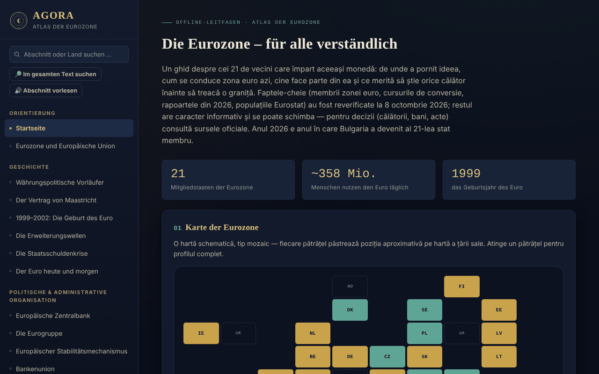

# AGORA — Atlas des Euroraums

[English](README.md) · [Română](README.ro.md) · [Français](README.fr.md) · [Italiano](README.it.md) · [Español](README.es.md) · [Português](README.pt.md) · **Deutsch** · [Magyar](README.hu.md)

**Version:** 1.2.0 · **Zuletzt aktualisiert:** 2026-10-19

Oberflächensprachen: **Română, English, Français, Italiano, Español, Português (PT), Deutsch, Magyar**

Offline-Leitfaden in einer einzigen HTML-Datei über den Euroraum: Geschichte, Institutionen, die 21 Mitgliedstaaten, Rumänien und der Euro, dazu ein praktischer Reiseführer. Persönliches, informatives, inoffizielles Projekt.

**Online-App:** https://chiuta.github.io/AGORA/

## Was es ist

AGORA versammelt in 59 Abschnitten (Menü links; ☰ auf Mobilgeräten) Erklärungen zur gemeinsamen Währung: von den Währungsvorläufern und dem Vertrag von Maastricht über die EZB, die Eurogruppe, den ESM, die Konvergenzkriterien, Rumänien und den Euro bis zu den EU-Rechten für Reisende und einem praktischen Leitfaden. Die wichtigsten Fakten wurden am **8. Oktober 2026** erneut geprüft, die EZB-Umfrage zu den Banknoten am **11. Oktober 2026** (siehe „Geprüfte Quellen“); der Rest des Textes ist informativ und kann sich ändern.

## Funktionen

Im Code geprüft:
- Kachelkarte der Staaten (Euroraum, EU außerhalb des Raums, Kleinstaaten, einseitige Verwendung) mit Detailfeld beim Antippen; filterbare Liste der Staaten nach Beitrittswellen.
- Suche im Menü (unabhängig von diakritischen Zeichen; Enter öffnet das Länderprofil) und im Glossar (33 Begriffe).
- Quiz mit 28 Fragen in gemischter Reihenfolge (Fisher–Yates), mit Erklärungen; am Ende erscheint die Liste „Zum Wiederholen“ (die falsch beantworteten Fragen, mit richtiger Antwort und Erklärung) und die Schaltfläche „Nur die falschen Fragen wiederholen“.
- Lokale Rechner: Lei-Euro-Umrechner mit manuell eingegebenem Kurs, Luftlinienentfernung zwischen Hauptstädten (Haversine), Reisebudget, Zielempfehlung, Packlisten-Generator.
- Reisetagebuch: wird nur im Speicher der Seite gehalten; kann als JSON-Datei exportiert/importiert werden (beim Import werden Länder, Daten und Länge der Notizen validiert).
- Umschalter Tag-/Nachtmodus; beim ersten Öffnen wird die Systemeinstellung für das helle Design berücksichtigt.
- Direkte Links zu Abschnitten (`#state-membre`) und die Zurück-/Vorwärts-Schaltflächen des Browsers; das Kürzel „/“ öffnet die Menüsuche; das Drucken (Strg+P) gibt den aktuellen Abschnitt ohne Menü aus.

## Anleitung

1. Wähle einen Abschnitt im Menü links (auf Mobilgeräten ☰ drücken); du kannst nach Titel oder nach Land suchen.
2. Tippe in der „Interaktiven Karte“ auf eine Kachel, um das Länderprofil zu sehen; „Schließen ✕“ blendet es aus.
3. Filtere in „Länderprofile“ nach Beitrittswelle und tippe auf ein Land.
4. Gib im „Manuellen Umrechner“ den Tageskurs selbst ein (zum Beispiel von bnr.ro) und den Betrag; der Atlas holt keine Kurse aus dem Internet.
5. Beantworte im „Quiz“ die Fragen; am Ende siehst du die falschen Fragen noch einmal und kannst nur diese wiederholen; „Von vorn beginnen“ startet das ganze Quiz neu.
6. Füge im „Reisetagebuch“ Besuche hinzu; um sie zu behalten, nutze „Exportieren (.json)“ und später „Importieren (.json)“.

## Datenschutz und Netzwerk

- **Speicher:** Es werden weder `localStorage`, `sessionStorage`, IndexedDB noch Cookies verwendet. Das Tagebuch und die Ergebnisse der Rechner verschwinden beim Neuladen der Seite, sofern du das Tagebuch nicht exportierst.
- **Netzwerk:** Es werden keine Netzwerkanfragen gestellt (kein `fetch`, keine externen Skripte, Schriftarten oder Bilder). Die CSP-Richtlinie der Seite blockiert externe Verbindungen.
- **Externe Links** (öffnen sich nur beim Klick, in einem neuen Tab, mit `rel=noopener`; das Senden des Referrers ist deaktiviert): Websites von Eisenbahnunternehmen (oebb.at, belgiantrain.be, bdz.bg, hzpp.hr, elron.ee, vr.fi, sncf-connect.com, bahn.de, hellenictrain.gr, irishrail.ie, trenitalia.com, vivi.lv, ltglink.lt, cfl.lu, ns.nl, cp.pt, zssk.sk, potniski.sz.si, renfe.com), interrail.com, thetrainline.com, omio.com, flixbus.com, mae.ro, econsulat.ro, cardeuropean.ro, chiuta.github.io und trom.tf. Erwähnungen kommerzieller Dienste (Bahn, Fintech) sind informativ, keine Empfehlungen.
- **Berechtigungen:** Es werden keine Browserberechtigungen angefordert.
- Es gibt kein Konto, keine Telemetrie und keine Verkehrsanalyse.

## Geprüfte Quellen (8. Oktober 2026)

- Bulgarien — Mitglied des Euroraums seit dem 1. Januar 2026, 21. Staat, fester Kurs 1 EUR = 1,95583 BGN: ECOFIN-Rat (Juli 2025), EZB, Banque de France, Europäisches Parlament (EPRS).
- Konvergenzberichte vom 24. Juni 2026 (Europäische Kommission und EZB): Referenzwerte 2,7 % (Inflation) und 5,1 % (langfristige Zinsen); Tschechien und Schweden erfüllen drei von vier Kriterien; Rumänien: Inflation 8,4 %, Zinsen 6,7 %, Defizit 7,9 % des BIP im Jahr 2025, Schuldenstand 59,3 % (Prognose 63,4 % im Jahr 2027), außerhalb des WKM II.
- Bevölkerung: Eurostat, `tps00001`, 1. Januar 2025 (Euroraum, 21 Staaten: 358,7 Mio.).
- Flash-Eurobarometer 583 (17. April – 4. Mai 2026): Unterstützung für den Euro in Rumänien 65 %, in Ungarn 80 %.
- EZB, Mitteilung vom 23. Juli 2026: zehn Designvorschläge für die neuen Banknoten; Mitteilung vom 23. September 2026: An der öffentlichen Umfrage (23. Juli – 21. September) nahmen 9,96 Millionen Menschen teil, endgültige Entscheidung um das Ende des Jahres 2026 (geprüft am 11.10.2026).
- Digitaler Euro: Abstimmung im ECON-Ausschuss des Europäischen Parlaments am 23. Juni 2026 (noch nicht im Plenum).
- TAROM: erste Boeing 737 MAX am 12. September 2026 übernommen (Luftfahrtpresse).
- Vorsitz der Eurogruppe: Kyriakos Pierrakakis (gewählt im Dezember 2025).

## Grenzen und Warnhinweise

- Informativer, **inoffizieller** Leitfaden ohne Rechtswirkung; er stellt keine Finanz-, Rechts- oder medizinische Beratung dar und steht in keiner Verbindung zur EZB, zur Europäischen Kommission oder zu anderen Institutionen.
- Die Daten ändern sich (Wechselkurse, Tarife, Reiseregeln, Fahrpläne). Prüfe für Entscheidungen die offiziellen Quellen.
- Die Flächen der Staaten, die Mehrwertsteuersätze, die Fahrpläne und Transportdauern, die Zahl der Staaten mit Pfandsystemen und die Angaben in den praktischen Abschnitten wurden nicht erneut an einer einzigen offiziellen Quelle geprüft; betrachte sie als Richtwerte.
- Die Entfernungen sind Luftlinie, nicht Straßenentfernung.
- Der Budgetrechner verwendet allgemeine Durchschnittswerte, keine realen Preise.

## Lokale Ausführung / offline

Lade `index.html` herunter und öffne sie in einem Browser; sie funktioniert ohne Internet.

## Neue Funktionen (v1.1.0)

- **Suche im gesamten Atlas** (Schaltfläche „Im gesamten Text suchen“, FFF.search): Treffer ohne diakritische Zeichen und tolerant gegenüber kleinen Tippfehlern („Maastrich“ findet Maastricht), mit direktem Sprung zum Abschnitt; übernimmt den Text aus der Menüsuche. Ohne Netzwerk.
- **Vorlesen des Abschnitts** (FFF.tts), mit Stimmauswahl.
- Gemeinsames Kit (core, label, bundle, tts, search): Versionsetikett, .fff.json-Sicherungskopie.
- Die neuen Texte liegen in allen Sprachen der Anwendung vor (einschließlich hu/de, wo ein i18n-System existiert); maschinelle Übersetzungen sind nicht muttersprachlich geprüft.
- Tests: `tests/fff-r8.test.mjs` (Netzwerk gesperrt, axe 0 Verstöße bei 1280 und 360 px, auch bei geöffnetem Suchdialog).

## Verlauf / Changelog

### 14. Oktober 2026 (v1.1.0)
- Neu: lokale Suche im gesamten Atlas, Vorlesen des Abschnitts, gemeinsames Kit, Tests.

### 1.0.0 — 12. Oktober 2026
- Version und Datum der letzten Aktualisierung werden in der Anwendung angezeigt (Fußzeile).

### 11.10.2026 (dritte Aktualisierung) — 11. Oktober 2026
- Quiz: Das Ergebnis listet die falsch beantworteten Fragen („Zum Wiederholen“) mit richtiger Antwort und Erklärung auf und erlaubt, nur diese zu wiederholen (alles bleibt im Speicher der Seite).

### 11.10.2026 (zweite Aktualisierung) — 11. Oktober 2026
- Direkte Links zu Abschnitten über `#id`, mit funktionierendem Zurück/Vorwärts und aktualisiertem Seitentitel (ohne lokalen Speicher).
- Das helle Systemdesign wird beim ersten Öffnen berücksichtigt; Druckstil für den aktuellen Abschnitt; Kürzel „/“ für die Menüsuche.

### 11.10.2026 — 11. Oktober 2026
- Barrierefreiheit: h1-Überschrift (AGORA), semantischer Kopfbereich für die mobile Leiste; axe-Prüfung ohne Verstöße.
- Aktualisierung: Die EZB-Umfrage zu den neuen Banknoten ist beendet (21. September 2026, 9,96 Millionen Teilnehmer; endgültige Entscheidung um das Ende des Jahres 2026; Umlauf ab den 2030er-Jahren).

## Lizenz

Die Lizenz ist noch nicht festgelegt.

## Autor

Alexio — Alexandru-Ionuț Chiuță, Kontakt: alexio@trom.tf

## Zusammenfassung

AGORA ist ein einteiliger, rumänischsprachiger Offline-Atlas des Euroraums (21 Mitglieder seit dem Beitritt Bulgariens am 1. Januar 2026): Geschichte, Institutionen, Länderprofile, Rumänien und der Euro sowie ein Reiseführer, mit Kachelkarte, Quiz, Glossar und kleinen lokalen Rechnern. Kein Speicher, keine Netzwerkanfragen, keine Berechtigungen; das Reisetagebuch lebt im Speicher und kann als JSON exportiert/importiert werden. Die wichtigsten Fakten wurden am 8. Oktober 2026 anhand von Quellen der EZB, der Europäischen Kommission und von Eurostat erneut geprüft; die übrigen Inhalte sind informativ. Lizenz noch nicht festgelegt.
