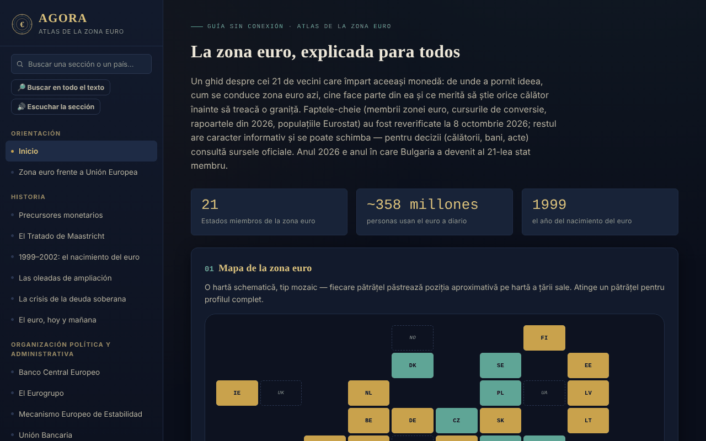

# AGORA — Atlas de la zona euro

[English](README.md) · [Română](README.ro.md) · [Français](README.fr.md) · [Italiano](README.it.md) · **Español** · [Português](README.pt.md) · [Deutsch](README.de.md) · [Magyar](README.hu.md)

**Versión:** 1.2.7 · **Última actualización:** 2026-10-26

Idiomas de la interfaz: **Română, English, Français, Italiano, Español, Português (PT), Deutsch, Magyar**

Guía sin conexión, en un único archivo HTML, sobre la zona euro: historia, instituciones, los 21 Estados miembros, Rumanía y el euro, además de una guía práctica para viajeros. Proyecto personal, informativo, no oficial.

**Aplicación en línea:** https://chiuta.github.io/AGORA/

## Qué es

AGORA reúne en 59 secciones (menú izquierdo; ☰ en móvil) explicaciones sobre la moneda única: desde los precursores monetarios y el Tratado de Maastricht hasta el BCE, el Eurogrupo, el MEDE, los criterios de convergencia, Rumanía y el euro, los derechos de los viajeros en la UE y una guía práctica. Los hechos clave se volvieron a comprobar el **8 de octubre de 2026**, y la encuesta del BCE sobre los billetes el **11 de octubre de 2026** (véase «Fuentes verificadas»); el resto del texto es informativo y puede cambiar.

## Funciones

Comprobadas en el código:
- Mapa en mosaico de los Estados (zona euro, UE fuera de la zona, microestados, uso unilateral) con panel de detalle al pulsar; lista filtrable de Estados por oleada de adhesión.
- Búsqueda en el menú (insensible a los diacríticos; Intro abre el perfil de un país) y en el glosario (33 términos).
- Cuestionario de 28 preguntas, en orden aleatorio (Fisher–Yates), con explicaciones; al final aparece la lista «Para repasar» (las preguntas falladas, con la respuesta correcta y la explicación) y el botón «Repetir solo las preguntas falladas».
- Calculadoras locales: conversor leu–euro con cambio introducido manualmente, distancia en línea recta entre capitales (haversine), presupuesto de viaje, recomendador de destinos, generador de lista de equipaje.
- Diario del viajero: se mantiene solo en la memoria de la página; se puede exportar/importar como archivo JSON (al importar se validan los países, las fechas y la longitud de las notas).
- Conmutador de modo día/noche; en la primera apertura se respeta la preferencia del sistema por el tema claro.
- Enlaces directos a secciones (`#state-membre`) y botones Atrás/Adelante del navegador; el atajo «/» abre la búsqueda del menú; la impresión (Ctrl+P) produce la sección actual, sin el menú.

## Manual de uso

1. Elige una sección en el menú izquierdo (en móvil, pulsa ☰); puedes buscar por título o por país.
2. En el «Mapa interactivo», pulsa una casilla para ver el perfil del país; «Cerrar ✕» lo oculta.
3. En «Perfiles de países», filtra por oleada de adhesión y pulsa un país.
4. En «Conversor manual», introduce tú el cambio del día (por ejemplo, de bnr.ro) y la cantidad; el atlas no toma cambios de internet.
5. En «Cuestionario», responde a las preguntas; al final repasas las falladas y puedes repetir solo esas; «Empezar de nuevo» reinicia todo el cuestionario.
6. En el «Diario del viajero», añade visitas; para conservarlas, usa «Exportar (.json)» y, más tarde, «Importar (.json)».

## Privacidad y red

- **Almacenamiento:** no usa `localStorage`, `sessionStorage`, IndexedDB ni cookies. El diario y los resultados de las calculadoras desaparecen al recargar la página, salvo que exportes el diario.
- **Red:** no realiza peticiones de red (sin `fetch`, scripts, fuentes ni imágenes externas). La política CSP de la página bloquea las conexiones externas.
- **Enlaces externos** (se abren solo al pulsar, en una pestaña nueva, con `rel=noopener`; el envío del referrer está desactivado): sitios de operadores ferroviarios (oebb.at, belgiantrain.be, bdz.bg, hzpp.hr, elron.ee, vr.fi, sncf-connect.com, bahn.de, hellenictrain.gr, irishrail.ie, trenitalia.com, vivi.lv, ltglink.lt, cfl.lu, ns.nl, cp.pt, zssk.sk, potniski.sz.si, renfe.com), interrail.com, thetrainline.com, omio.com, flixbus.com, mae.ro, econsulat.ro, cardeuropean.ro, chiuta.github.io y trom.tf. Las menciones de servicios comerciales (ferroviarios, fintech) son informativas, no recomendaciones.
- **Permisos:** no solicita ningún permiso del navegador.
- No hay cuenta, telemetría ni análisis de tráfico.

## Fuentes verificadas (8 de octubre de 2026)

- Bulgaria — miembro de la zona euro desde el 1 de enero de 2026, 21.º Estado, tipo fijo 1 EUR = 1,95583 BGN: Consejo ECOFIN (julio de 2025), BCE, Banque de France, Parlamento Europeo (EPRS).
- Informes de convergencia del 24 de junio de 2026 (Comisión Europea y BCE): valores de referencia 2,7 % (inflación) y 5,1 % (tipos de interés a largo plazo); Chequia y Suecia cumplen tres de los cuatro criterios; Rumanía: inflación 8,4 %, tipos de interés 6,7 %, déficit del 7,9 % del PIB en 2025, deuda 59,3 % (proyección 63,4 % en 2027), fuera del MTC II.
- Poblaciones: Eurostat, `tps00001`, 1 de enero de 2025 (zona euro, 21 Estados: 358,7 millones).
- Flash Eurobarómetro 583 (17 de abril – 4 de mayo de 2026): apoyo al euro en Rumanía 65 %, en Hungría 80 %.
- BCE, comunicado del 23 de julio de 2026: diez propuestas de diseño para los nuevos billetes; comunicado del 23 de septiembre de 2026: la encuesta pública (23 de julio – 21 de septiembre) tuvo 9,96 millones de participantes, decisión final hacia finales de 2026 (verificado el 11.10.2026).
- Euro digital: votación de la comisión ECON del Parlamento Europeo el 23 de junio de 2026 (todavía no en el pleno).
- TAROM: primer Boeing 737 MAX recibido el 12 de septiembre de 2026 (prensa aeronáutica).
- Presidencia del Eurogrupo: Kyriakos Pierrakakis (elegido en diciembre de 2025).

## Límites y advertencias

- Guía informativa, **no oficial**, sin valor jurídico; no constituye asesoramiento financiero, jurídico ni médico y no tiene relación con el BCE, la Comisión Europea ni otras instituciones.
- Los datos cambian (tipos de cambio, tarifas, normas de viaje, horarios). Para tomar decisiones, comprueba las fuentes oficiales.
- Las superficies de los Estados, los tipos de IVA, los horarios y duraciones de transporte, el número de Estados con sistemas de depósito y devolución y la información de las secciones prácticas no se han vuelto a comprobar en una única fuente oficial; trátalos como orientativos.
- Las distancias son en línea recta, no por carretera.
- La calculadora de presupuesto usa medias generales, no precios reales.

## Ejecución local / sin conexión

Descarga `index.html` y ábrelo en un navegador; funciona sin internet.

## Novedades (v1.1.0)

- **Búsqueda en todo el atlas** (botón «Buscar en todo el texto», FFF.search): coincidencia sin diacríticos y tolerante a pequeños errores («Maastrich» encuentra Maastricht), con salto directo a la sección; toma el texto de la búsqueda del menú. Sin red.
- **Lectura de la sección en voz alta** (FFF.tts), con selección de voz.
- Kit común (core, label, bundle, tts, search): etiqueta de versión, copia .fff.json.
- Los nuevos textos están en todos los idiomas de la aplicación (incluidos hu/de donde existe un sistema i18n); las traducciones automáticas no están verificadas por hablantes nativos.
- Pruebas: `tests/fff-r8.test.mjs` (red bloqueada, axe 0 infracciones a 1280 y 360 px, también con el diálogo de búsqueda abierto).

## Historial / Registro de cambios

### 1.2.5 — 2026-10-22
- fff-kit 1.1.4: objetivos táctiles y tamaño mínimo de texto; objetivos táctiles/texto corregidos

### 1.2.4 — 2026-10-22
- fff-kit 1.1.2: PBKDF2 600 000 iteraciones, protección anti-clickjacking

### 1.2.3 — 2026-10-22
- Accesibilidad: los campos de país, fecha e importación del diario de viaje tienen ahora un nombre que anuncian los lectores de pantalla (en los 8 idiomas).
- Móvil: el texto, las etiquetas y las cabeceras de tabla miden al menos 12 px en pantallas estrechas; el botón de versión tiene un área táctil mayor.

### 1.2.2 — 2026-10-22
- Corregido el texto rumano residual en los demás idiomas: los dos títulos de sección (nueva serie de billetes, sistema europeo de garantía de depósitos) y las dos líneas del pie de página ya están traducidos.

### 14 de octubre de 2026 (v1.1.0)
- Nuevo: búsqueda local en todo el atlas, lectura de la sección en voz alta, kit común, pruebas.

### 1.0.0 — 12 de octubre de 2026
- La versión y la fecha de la última actualización se muestran en la aplicación (pie de página).

### 11.10.2026 (tercera actualización) — 11 de octubre de 2026
- Cuestionario: el resultado enumera las preguntas falladas («Para repasar») con la respuesta correcta y la explicación y permite repetir solo esas (todo permanece en la memoria de la página).

### 11.10.2026 (segunda actualización) — 11 de octubre de 2026
- Enlaces directos a secciones mediante `#id`, con Atrás/Adelante funcionales y título de página actualizado (sin almacenamiento local).
- Se respeta el tema claro del sistema en la primera apertura; estilo de impresión para la sección actual; atajo «/» para la búsqueda del menú.

### 11.10.2026 — 11 de octubre de 2026
- Accesibilidad: título h1 (AGORA), encabezado semántico para la barra móvil; comprobación axe sin infracciones.
- Actualización: ha terminado la encuesta del BCE sobre los nuevos billetes (21 de septiembre de 2026, 9,96 millones de participantes; decisión final hacia finales de 2026; circulación a partir de la década de 2030).

## Licencia

La licencia aún no está declarada.

## Autor

Alexio — Alexandru-Ionuț Chiuță, contacto: alexio@trom.tf

## Resumen

AGORA es un atlas sin conexión, en un único archivo y en rumano, de la zona euro (21 miembros desde la adhesión de Bulgaria el 1 de enero de 2026): historia, instituciones, perfiles de países, Rumanía y el euro, y una guía del viajero, con mapa en mosaico, cuestionario, glosario y pequeñas calculadoras locales. Sin almacenamiento, sin peticiones de red, sin permisos; el diario de viaje vive en memoria y se puede exportar/importar como JSON. Los hechos clave se volvieron a comprobar el 8 de octubre de 2026 con fuentes del BCE, la Comisión Europea y Eurostat; el resto del contenido es informativo. Licencia aún no declarada.
