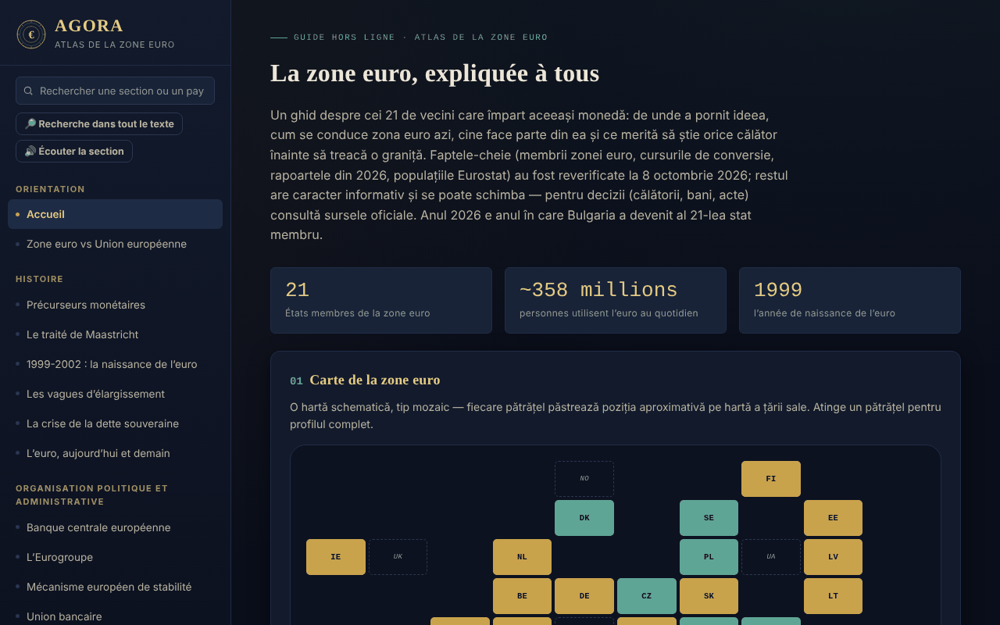

# AGORA — Atlas de la zone euro

[English](README.md) · [Română](README.ro.md) · **Français** · [Italiano](README.it.md) · [Español](README.es.md) · [Português](README.pt.md) · [Deutsch](README.de.md) · [Magyar](README.hu.md)

**Version :** 1.2.4 · **Dernière mise à jour :** 2026-10-22

Langues de l'interface : **Română, English, Français, Italiano, Español, Português (PT), Deutsch, Magyar**

Guide hors ligne, dans un seul fichier HTML, sur la zone euro : histoire, institutions, les 21 États membres, la Roumanie et l'euro, ainsi qu'un guide pratique pour les voyageurs. Projet personnel, informatif, non officiel.

**Application en ligne :** https://chiuta.github.io/AGORA/

## Présentation

AGORA rassemble, en 59 sections (menu de gauche ; ☰ sur mobile), des explications sur la monnaie unique : des précurseurs monétaires et du traité de Maastricht à la BCE, l'Eurogroupe, le MES, les critères de convergence, la Roumanie et l'euro, les droits des voyageurs dans l'UE et un guide pratique. Les faits essentiels ont été revérifiés le **8 octobre 2026**, et l'enquête de la BCE sur les billets le **11 octobre 2026** (voir « Sources vérifiées ») ; le reste du texte est informatif et peut changer.

## Fonctionnalités

Vérifiées dans le code :
- Carte en mosaïque des États (zone euro, UE hors zone, micro-États, usage unilatéral) avec panneau de détail au clic ; liste filtrable des États par vague d'adhésion.
- Recherche dans le menu (insensible aux diacritiques ; Entrée ouvre le profil d'un pays) et dans le glossaire (33 termes).
- Quiz de 28 questions, dans un ordre mélangé (Fisher–Yates), avec explications ; à la fin apparaît la liste « À revoir » (les questions manquées, avec la bonne réponse et l'explication) et le bouton « Refaire uniquement les questions manquées ».
- Calculateurs locaux : convertisseur leu–euro avec taux saisi manuellement, distance à vol d'oiseau entre capitales (haversine), budget de voyage, recommandation de destination, générateur de liste de bagages.
- Journal du voyageur : conservé uniquement dans la mémoire de la page ; il peut être exporté/importé en fichier JSON (à l'import, les pays, les dates et la longueur des notes sont validés).
- Commutateur de mode jour/nuit ; à la première ouverture, la préférence du système pour le thème clair est respectée.
- Liens directs vers les sections (`#state-membre`) et boutons Précédent/Suivant du navigateur ; le raccourci « / » ouvre la recherche du menu ; l'impression (Ctrl+P) produit la section en cours, sans le menu.

## Mode d'emploi

1. Choisissez une section dans le menu de gauche (sur mobile, appuyez sur ☰) ; vous pouvez chercher par titre ou par pays.
2. Dans la « Carte interactive », appuyez sur une petite tuile pour voir le profil du pays ; « Fermer ✕ » le masque.
3. Dans « Profils de pays », filtrez par vague d'adhésion et appuyez sur un pays.
4. Dans « Convertisseur manuel », saisissez vous-même le taux du jour (par exemple depuis bnr.ro) et le montant ; l'atlas ne récupère pas de taux sur internet.
5. Dans « Quiz », répondez aux questions ; à la fin, vous revoyez les questions manquées et pouvez refaire uniquement celles-ci ; « Recommencer » relance tout le quiz.
6. Dans le « Journal du voyageur », ajoutez des visites ; pour les conserver, utilisez « Exporter (.json) » puis, plus tard, « Importer (.json) ».

## Confidentialité et réseau

- **Stockage :** n'utilise ni `localStorage`, ni `sessionStorage`, ni IndexedDB, ni cookies. Le journal et les résultats des calculateurs disparaissent au rechargement de la page, sauf si vous exportez le journal.
- **Réseau :** ne fait aucune requête réseau (pas de `fetch`, de scripts, de polices ni d'images externes). La politique CSP de la page bloque les connexions externes.
- **Liens externes** (ouverts uniquement au clic, dans un nouvel onglet, avec `rel=noopener` ; l'envoi du référent est désactivé) : sites d'opérateurs ferroviaires (oebb.at, belgiantrain.be, bdz.bg, hzpp.hr, elron.ee, vr.fi, sncf-connect.com, bahn.de, hellenictrain.gr, irishrail.ie, trenitalia.com, vivi.lv, ltglink.lt, cfl.lu, ns.nl, cp.pt, zssk.sk, potniski.sz.si, renfe.com), interrail.com, thetrainline.com, omio.com, flixbus.com, mae.ro, econsulat.ro, cardeuropean.ro, chiuta.github.io et trom.tf. Les mentions de services commerciaux (ferroviaires, fintech) sont informatives, et non des recommandations.
- **Autorisations :** ne demande aucune autorisation au navigateur.
- Il n'y a ni compte, ni télémétrie, ni analyse de trafic.

## Sources vérifiées (8 octobre 2026)

- Bulgarie — membre de la zone euro depuis le 1er janvier 2026, 21e État, taux fixe 1 EUR = 1,95583 BGN : Conseil ECOFIN (juillet 2025), BCE, Banque de France, Parlement européen (EPRS).
- Rapports de convergence du 24 juin 2026 (Commission européenne et BCE) : valeurs de référence 2,7 % (inflation) et 5,1 % (taux d'intérêt à long terme) ; la Tchéquie et la Suède remplissent trois critères sur quatre ; Roumanie : inflation 8,4 %, taux d'intérêt 6,7 %, déficit de 7,9 % du PIB en 2025, dette de 59,3 % (projection de 63,4 % en 2027), hors MCE II.
- Populations : Eurostat, `tps00001`, 1er janvier 2025 (zone euro, 21 États : 358,7 millions).
- Flash Eurobaromètre 583 (17 avril – 4 mai 2026) : soutien à l'euro en Roumanie 65 %, en Hongrie 80 %.
- BCE, communiqué du 23 juillet 2026 : dix propositions de design pour les nouveaux billets ; communiqué du 23 septembre 2026 : l'enquête publique (23 juillet – 21 septembre) a compté 9,96 millions de participants, décision finale vers la fin de 2026 (vérifié le 11.10.2026).
- Euro numérique : vote de la commission ECON du Parlement européen le 23 juin 2026 (pas encore en plénière).
- TAROM : premier Boeing 737 MAX réceptionné le 12 septembre 2026 (presse aéronautique).
- Présidence de l'Eurogroupe : Kyriakos Pierrakakis (élu en décembre 2025).

## Limites et avertissements

- Guide informatif, **non officiel**, sans valeur juridique ; il ne constitue pas un conseil financier, juridique ou médical et n'a aucun lien avec la BCE, la Commission européenne ou d'autres institutions.
- Les données changent (taux de change, tarifs, règles de voyage, horaires). Pour toute décision, vérifiez les sources officielles.
- Les superficies des États, les taux de TVA, les horaires et durées de transport, le nombre d'États dotés de systèmes de consigne et les informations des sections pratiques n'ont pas été revérifiés auprès d'une source officielle unique ; considérez-les comme indicatifs.
- Les distances sont à vol d'oiseau, pas par la route.
- Le calculateur de budget utilise des moyennes générales, pas des prix réels.

## Exécution locale / hors ligne

Téléchargez `index.html` et ouvrez-le dans un navigateur ; il fonctionne sans internet.

## Nouveautés (v1.1.0)

- **Recherche dans tout l'atlas** (bouton « Rechercher dans tout le texte », FFF.search) : correspondance sans diacritiques et tolérante aux petites fautes (« Maastrich » trouve Maastricht), avec saut direct à la section ; reprend le texte de la recherche du menu. Sans réseau.
- **Lecture de la section à voix haute** (FFF.tts), avec choix de la voix.
- Kit commun (core, label, bundle, tts, search) : étiquette de version, copie .fff.json.
- Les nouveaux textes sont dans toutes les langues de l'application (y compris hu/de là où il existe un système i18n) ; les traductions automatiques ne sont pas vérifiées par des locuteurs natifs.
- Tests : `tests/fff-r8.test.mjs` (réseau bloqué, axe 0 violation à 1280 et 360 px, y compris avec la boîte de dialogue de recherche ouverte).

## Historique / Journal des modifications

### 1.2.4 — 2026-10-22
- fff-kit 1.1.2 : PBKDF2 600 000 itérations, protection anti-clickjacking

### 1.2.3 — 2026-10-22
- Accessibilité : les champs pays, date et import du journal de voyage ont désormais un nom annoncé par les lecteurs d'écran (dans les 8 langues).
- Mobile : le texte, les pastilles et les en-têtes de tableau font au moins 12 px sur les écrans étroits ; le bouton de version a une cible tactile plus grande.

### 1.2.2 — 2026-10-22
- Texte roumain résiduel corrigé dans les autres langues : les deux titres de section (nouvelle série de billets, système européen d'assurance des dépôts) et les deux lignes du pied de page sont désormais traduits.

### 14 octobre 2026 (v1.1.0)
- Nouveau : recherche locale dans tout l'atlas, lecture de la section à voix haute, kit commun, tests.

### 1.0.0 — 12 octobre 2026
- La version et la date de dernière mise à jour sont affichées dans l'application (pied de page).

### 11.10.2026 (troisième mise à jour) — 11 octobre 2026
- Quiz : le résultat liste les questions manquées (« À revoir ») avec la bonne réponse et l'explication et permet de refaire uniquement celles-ci (tout reste dans la mémoire de la page).

### 11.10.2026 (deuxième mise à jour) — 11 octobre 2026
- Liens directs vers les sections par `#id`, avec Précédent/Suivant fonctionnels et titre de page mis à jour (sans stockage local).
- Le thème clair du système est respecté à la première ouverture ; style d'impression pour la section en cours ; raccourci « / » pour la recherche du menu.

### 11.10.2026 — 11 octobre 2026
- Accessibilité : titre h1 (AGORA), en-tête sémantique pour la barre mobile ; vérification axe sans violation.
- Mise à jour : l'enquête de la BCE sur les nouveaux billets est terminée (21 septembre 2026, 9,96 millions de participants ; décision finale vers la fin de 2026 ; mise en circulation à partir des années 2030).

## Licence

La licence n'est pas encore déclarée.

## Auteur

Alexio — Alexandru-Ionuț Chiuță, contact : alexio@trom.tf

## Résumé

AGORA est un atlas hors ligne, en un seul fichier et en roumain, de la zone euro (21 membres depuis l'adhésion de la Bulgarie le 1er janvier 2026) : histoire, institutions, profils de pays, la Roumanie et l'euro, et un guide du voyageur, avec carte en mosaïque, quiz, glossaire et petits calculateurs locaux. Pas de stockage, pas de requêtes réseau, pas d'autorisations ; le journal de voyage vit en mémoire et peut être exporté/importé en JSON. Les faits essentiels ont été revérifiés le 8 octobre 2026 auprès de sources de la BCE, de la Commission européenne et d'Eurostat ; le reste du contenu est informatif. Licence non encore déclarée.
