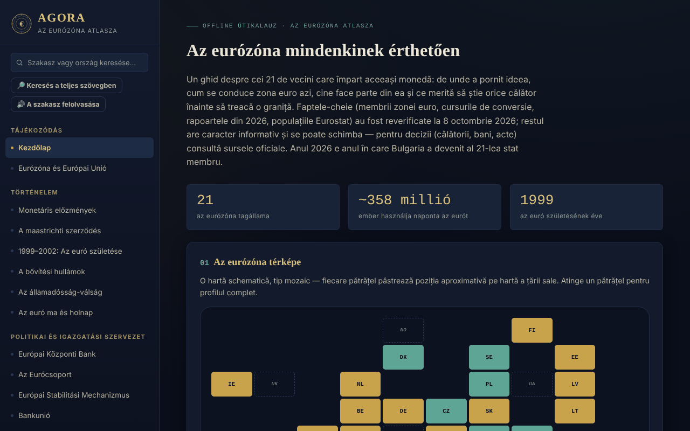

# AGORA — Az euróövezet atlasza

[English](README.md) · [Română](README.ro.md) · [Français](README.fr.md) · [Italiano](README.it.md) · [Español](README.es.md) · [Português](README.pt.md) · [Deutsch](README.de.md) · **Magyar**

**Verzió:** 1.2.3 · **Utolsó frissítés:** 2026-10-22

A felület nyelvei: **Română, English, Français, Italiano, Español, Português (PT), Deutsch, Magyar**

Offline útmutató egyetlen HTML-fájlban az euróövezetről: történelem, intézmények, a 21 tagállam, Románia és az euró, valamint gyakorlati útmutató utazóknak. Személyes, tájékoztató jellegű, nem hivatalos projekt.

**Online alkalmazás:** https://chiuta.github.io/AGORA/

## Mi ez

Az AGORA 59 szekcióban (bal oldali menü; mobilon ☰) gyűjti össze az egységes pénzről szóló magyarázatokat: a monetáris előzményektől és a maastrichti szerződéstől az EKB-n, az Eurócsoporton, az ESM-en és a konvergenciakritériumokon át Romániáig és az euróig, az uniós utazói jogokig és egy gyakorlati útmutatóig. A legfontosabb tényeket **2026. október 8-án** ellenőriztük újra, az EKB bankjegyekről szóló felmérését pedig **2026. október 11-én** (lásd „Ellenőrzött források”); a szöveg többi része tájékoztató jellegű, és változhat.

## Funkciók

Kódban ellenőrizve:
- Az államok mozaiktérképe (euróövezet, az övezeten kívüli EU, miniállamok, egyoldalú használat) kattintásra megjelenő részletpanellel; az államok szűrhető listája csatlakozási hullámok szerint.
- Keresés a menüben (ékezetekre érzéketlen; az Enter megnyitja egy ország profilját) és a szójegyzékben (33 fogalom).
- 28 kérdéses kvíz, kevert sorrendben (Fisher–Yates), magyarázatokkal; a végén megjelenik az „Átnézendő” lista (a hibásan megválaszolt kérdések a helyes válasszal és a magyarázattal) és a „Csak a hibás kérdések ismétlése” gomb.
- Helyi számolók: lej–euró átváltó kézzel megadott árfolyammal, légvonalbeli távolság a fővárosok között (haversine), utazási költségvetés, úticél-ajánló, csomaglista-generátor.
- Az utazó naplója: csak az oldal memóriájában él; exportálható/importálható JSON-fájlként (importáláskor az országokat, a dátumokat és a jegyzetek hosszát ellenőrzi).
- Nappali/éjszakai mód váltó; az első megnyitáskor a rendszer világos témára vonatkozó beállítását tiszteletben tartja.
- Közvetlen hivatkozások a szekciókra (`#state-membre`) és a böngésző Vissza/Előre gombjai; a „/” billentyűparancs megnyitja a menükeresőt; a nyomtatás (Ctrl+P) az aktuális szekciót adja ki menü nélkül.

## Használati útmutató

1. Válassz egy szekciót a bal oldali menüből (mobilon nyomd meg a ☰ gombot); kereshetsz cím vagy ország szerint.
2. Az „Interaktív térképen” nyomj meg egy négyzetet az ország profiljához; a „Bezárás ✕” elrejti.
3. Az „Országprofilok” között szűrj csatlakozási hullám szerint, és nyomj meg egy országot.
4. A „Kézi átváltónál” te adod meg a napi árfolyamot (például a bnr.ro-ról) és az összeget; az atlasz nem tölt le árfolyamokat az internetről.
5. A „Kvízben” válaszolj a kérdésekre; a végén átnézheted a hibásakat, és csak azokat ismételheted meg; az „Újrakezdés” az egész kvízt újraindítja.
6. Az „Utazó naplójában” adj hozzá látogatásokat; megőrzésükhöz használd az „Exportálás (.json)”, majd később az „Importálás (.json)” gombot.

## Adatvédelem és hálózat

- **Tárolás:** nem használ `localStorage`-t, `sessionStorage`-t, IndexedDB-t vagy sütiket. A napló és a számolók eredményei az oldal újratöltésekor eltűnnek, hacsak nem exportálod a naplót.
- **Hálózat:** nem küld hálózati kéréseket (nincs `fetch`, külső szkript, betűtípus vagy kép). Az oldal CSP-szabályzata blokkolja a külső kapcsolatokat.
- **Külső hivatkozások** (csak kattintásra nyílnak meg, új lapon, `rel=noopener` beállítással; a hivatkozó (referrer) küldése letiltva): vasúti üzemeltetők weboldalai (oebb.at, belgiantrain.be, bdz.bg, hzpp.hr, elron.ee, vr.fi, sncf-connect.com, bahn.de, hellenictrain.gr, irishrail.ie, trenitalia.com, vivi.lv, ltglink.lt, cfl.lu, ns.nl, cp.pt, zssk.sk, potniski.sz.si, renfe.com), interrail.com, thetrainline.com, omio.com, flixbus.com, mae.ro, econsulat.ro, cardeuropean.ro, chiuta.github.io és trom.tf. A kereskedelmi szolgáltatások (vasút, fintech) említése tájékoztató jellegű, nem ajánlás.
- **Engedélyek:** nem kér böngészőengedélyt.
- Nincs fiók, telemetria vagy forgalomelemzés.

## Ellenőrzött források (2026. október 8.)

- Bulgária — 2026. január 1-jétől az euróövezet tagja, a 21. állam, rögzített árfolyam 1 EUR = 1,95583 BGN: ECOFIN Tanács (2025. július), EKB, Banque de France, Európai Parlament (EPRS).
- A 2026. június 24-i konvergenciajelentések (Európai Bizottság és EKB): referenciaértékek 2,7% (infláció) és 5,1% (hosszú lejáratú kamatok); Csehország és Svédország a négy kritériumból hármat teljesít; Románia: infláció 8,4%, kamatok 6,7%, hiány a GDP 7,9%-a 2025-ben, adósság 59,3% (előrejelzés 63,4% 2027-ben), az ERM II-n kívül.
- Népesség: Eurostat, `tps00001`, 2025. január 1. (euróövezet, 21 állam: 358,7 millió).
- 583. Flash Eurobarométer (2026. április 17. – május 4.): az euró támogatottsága Romániában 65%, Magyarországon 80%.
- EKB, a 2026. július 23-i közlemény: tíz dizájnjavaslat az új bankjegyekre; a 2026. szeptember 23-i közlemény: a nyilvános felmérésen (július 23. – szeptember 21.) 9,96 millió résztvevő vett részt, a végleges döntés 2026 végén várható (ellenőrizve 2026. 10. 11-én).
- Digitális euró: az Európai Parlament ECON bizottságának szavazása 2026. június 23-án (a plenáris ülésen még nem).
- TAROM: az első Boeing 737 MAX átvétele 2026. szeptember 12-én (légiközlekedési sajtó).
- Az Eurócsoport elnöksége: Kyriakos Pierrakakis (megválasztva 2025 decemberében).

## Korlátok és figyelmeztetések

- Tájékoztató jellegű, **nem hivatalos** útmutató, jogi érték nélkül; nem minősül pénzügyi, jogi vagy orvosi tanácsadásnak, és semmilyen kapcsolatban nem áll az EKB-val, az Európai Bizottsággal vagy más intézményekkel.
- Az adatok változnak (árfolyamok, díjszabások, utazási szabályok, menetrendek). Döntések előtt ellenőrizd a hivatalos forrásokat.
- Az államok területét, az áfakulcsokat, a menetrendeket és szállítási időket, a betétdíjas rendszerrel rendelkező államok számát és a gyakorlati szekciók információit nem ellenőriztük újra egyetlen hivatalos forrásnál; tekintsd őket tájékoztató jellegűnek.
- A távolságok légvonalban értendők, nem közúton.
- A költségvetés-számoló általános átlagokat használ, nem valós árakat.

## Helyi futtatás / offline

Töltsd le az `index.html` fájlt, és nyisd meg egy böngészőben; internet nélkül is működik.

## Újdonságok (v1.1.0)

- **Keresés az egész atlaszban** („Keresés a teljes szövegben” gomb, FFF.search): ékezetek nélküli és kisebb elírásokat toleráló egyezés („Maastrich” megtalálja Maastrichtot), közvetlen ugrással a szekcióra; átveszi a menükeresőben megadott szöveget. Hálózat nélkül.
- **A szekció felolvasása** (FFF.tts), hangválasztással.
- Közös készlet (core, label, bundle, tts, search): verziócímke, .fff.json másolat.
- Az új szövegek az alkalmazás minden nyelvén megvannak (a hu/de nyelven is, ahol van i18n-rendszer); a gépi fordításokat anyanyelvi beszélők nem ellenőrizték.
- Tesztek: `tests/fff-r8.test.mjs` (letiltott hálózat, axe 0 szabálysértés 1280 és 360 px-nél, megnyitott keresőablakkal is).

## Előzmények / Változásnapló

### 1.2.3 — 2026-10-22
- Akadálymentesség: az útinapló ország-, dátum- és importmezői mostantól a képernyőolvasók által felolvasott névvel rendelkeznek (mind a 8 nyelven).
- Mobil: a szöveg, a csempék és a táblázatfejlécek keskeny képernyőn legalább 12 px méretűek; a verziógomb érintési felülete nagyobb.

### 1.2.2 — 2026-10-22
- Kijavítva a többi nyelvben maradt román szöveg: a két szakaszcím (új bankjegysorozat, európai betétbiztosítási rendszer) és a lábléc két sora most már le van fordítva.

### 2026. október 14. (v1.1.0)
- Új: helyi keresés az egész atlaszban, a szekció felolvasása, közös készlet, tesztek.

### 1.0.0 — 2026. október 12.
- A verzió és az utolsó frissítés dátuma megjelenik az alkalmazásban (lábléc).

### 2026.10.11. (harmadik frissítés) — 2026. október 11.
- Kvíz: az eredmény felsorolja a hibásan megválaszolt kérdéseket („Átnézendő”) a helyes válasszal és a magyarázattal, és lehetővé teszi, hogy csak azokat ismételd meg (minden az oldal memóriájában marad).

### 2026.10.11. (második frissítés) — 2026. október 11.
- Közvetlen hivatkozások a szekciókra `#id` segítségével, működő Vissza/Előre gombokkal és frissített oldalcímmel (helyi tárolás nélkül).
- A rendszer világos témáját az első megnyitáskor tiszteletben tartja; nyomtatási stílus az aktuális szekcióhoz; a „/” billentyűparancs a menükeresőhöz.

### 2026.10.11. — 2026. október 11.
- Akadálymentesség: h1 cím (AGORA), szemantikus fejléc a mobil sávhoz; axe-ellenőrzés szabálysértés nélkül.
- Frissítés: az EKB új bankjegyekről szóló felmérése lezárult (2026. szeptember 21., 9,96 millió résztvevő; a végleges döntés 2026 végén várható; forgalomba hozatal a 2030-as évektől).

## Licenc

A licenc még nincs megadva.

## Szerző

Alexio — Alexandru-Ionuț Chiuță, kapcsolat: alexio@trom.tf

## Összefoglaló

Az AGORA egy egyfájlos, offline, román nyelvű atlasz az euróövezetről (21 tag Bulgária 2026. január 1-jei csatlakozása óta): történelem, intézmények, országprofilok, Románia és az euró, valamint utazói útmutató, mozaiktérképpel, kvízzel, szójegyzékkel és kis helyi számolókkal. Nincs tárolás, nincsenek hálózati kérések, nincsenek engedélyek; az utazási napló a memóriában él, és JSON-ként exportálható/importálható. A legfontosabb tényeket 2026. október 8-án ellenőriztük újra az EKB, az Európai Bizottság és az Eurostat forrásai alapján; a további tartalom tájékoztató jellegű. A licenc még nincs megadva.
