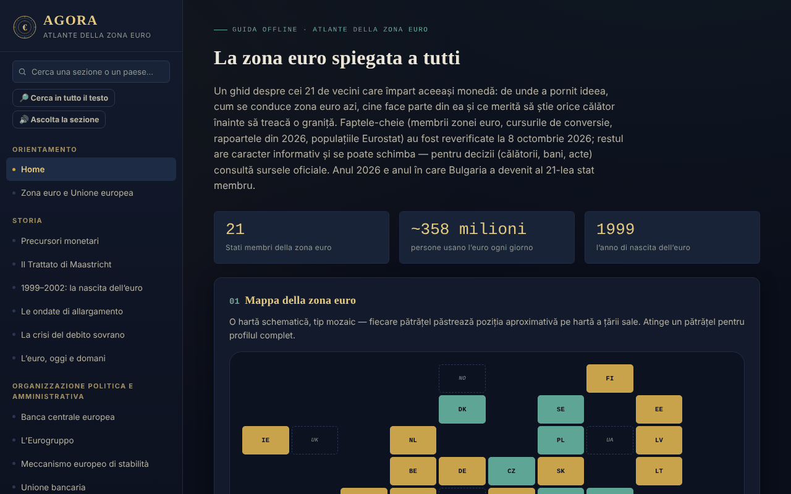

# AGORA — Atlante dell'Eurozona

[English](README.md) · [Română](README.ro.md) · [Français](README.fr.md) · **Italiano** · [Español](README.es.md) · [Português](README.pt.md) · [Deutsch](README.de.md) · [Magyar](README.hu.md)

**Versione:** 1.2.5 · **Ultimo aggiornamento:** 2026-10-22

Lingue dell'interfaccia: **Română, English, Français, Italiano, Español, Português (PT), Deutsch, Magyar**

Guida offline, in un unico file HTML, sull'Eurozona: storia, istituzioni, i 21 Stati membri, la Romania e l'euro, più una guida pratica per i viaggiatori. Progetto personale, informativo, non ufficiale.

**App online:** https://chiuta.github.io/AGORA/

## Che cos'è

AGORA raccoglie in 59 sezioni (menu a sinistra; ☰ su mobile) spiegazioni sulla moneta unica: dai precursori monetari e dal Trattato di Maastricht alla BCE, all'Eurogruppo, al MES, ai criteri di convergenza, alla Romania e l'euro, ai diritti dei viaggiatori nell'UE e a una guida pratica. I fatti principali sono stati ricontrollati l'**8 ottobre 2026**, e l'indagine della BCE sulle banconote l'**11 ottobre 2026** (vedi «Fonti verificate»); il resto del testo è informativo e può cambiare.

## Funzioni

Verificate nel codice:
- Mappa a mosaico degli Stati (Eurozona, UE fuori dall'area, microstati, uso unilaterale) con pannello di dettaglio al tocco; elenco filtrabile degli Stati per ondata di adesione.
- Ricerca nel menu (insensibile ai segni diacritici; Invio apre il profilo di un paese) e nel glossario (33 termini).
- Quiz di 28 domande, in ordine casuale (Fisher–Yates), con spiegazioni; alla fine compare l'elenco «Da rivedere» (le domande sbagliate, con la risposta corretta e la spiegazione) e il pulsante «Ripeti solo le domande sbagliate».
- Calcolatori locali: convertitore leu–euro con cambio inserito manualmente, distanza in linea retta tra capitali (haversine), budget di viaggio, consigliere di destinazioni, generatore di lista dei bagagli.
- Diario del viaggiatore: tenuto solo nella memoria della pagina; può essere esportato/importato come file JSON (all'importazione vengono validati paesi, date e lunghezza delle note).
- Interruttore modalità giorno/notte; alla prima apertura viene rispettata la preferenza di sistema per il tema chiaro.
- Link diretti alle sezioni (`#state-membre`) e pulsanti Indietro/Avanti del browser; la scorciatoia «/» apre la ricerca nel menu; la stampa (Ctrl+P) produce la sezione corrente, senza menu.

## Guida all'uso

1. Scegli una sezione dal menu a sinistra (su mobile premi ☰); puoi cercare per titolo o per paese.
2. Nella «Mappa interattiva» premi un tassello per il profilo del paese; «Chiudi ✕» lo nasconde.
3. In «Profili dei paesi» filtra per ondata di adesione e premi un paese.
4. In «Convertitore manuale» inserisci tu il cambio del giorno (per esempio da bnr.ro) e l'importo; l'atlante non preleva i cambi da internet.
5. In «Quiz» rispondi alle domande; alla fine rivedi quelle sbagliate e puoi ripetere solo quelle; «Ricomincia» riavvia l'intero quiz.
6. Nel «Diario del viaggiatore» aggiungi le visite; per conservarle usa «Esporta (.json)» e, in seguito, «Importa (.json)».

## Riservatezza e rete

- **Archiviazione:** non usa `localStorage`, `sessionStorage`, IndexedDB né cookie. Il diario e i risultati dei calcolatori scompaiono al ricaricamento della pagina, a meno che tu non esporti il diario.
- **Rete:** non effettua richieste di rete (nessun `fetch`, script, font o immagine esterna). La CSP della pagina blocca le connessioni esterne.
- **Link esterni** (si aprono solo al clic, in una nuova scheda, con `rel=noopener`; l'invio del referrer è disattivato): siti di operatori ferroviari (oebb.at, belgiantrain.be, bdz.bg, hzpp.hr, elron.ee, vr.fi, sncf-connect.com, bahn.de, hellenictrain.gr, irishrail.ie, trenitalia.com, vivi.lv, ltglink.lt, cfl.lu, ns.nl, cp.pt, zssk.sk, potniski.sz.si, renfe.com), interrail.com, thetrainline.com, omio.com, flixbus.com, mae.ro, econsulat.ro, cardeuropean.ro, chiuta.github.io e trom.tf. Le menzioni di servizi commerciali (ferroviari, fintech) sono informative, non raccomandazioni.
- **Permessi:** non richiede alcun permesso al browser.
- Non ci sono account, telemetria né analisi del traffico.

## Fonti verificate (8 ottobre 2026)

- Bulgaria — membro dell'Eurozona dal 1° gennaio 2026, 21° Stato, cambio fisso 1 EUR = 1,95583 BGN: Consiglio ECOFIN (luglio 2025), BCE, Banque de France, Parlamento europeo (EPRS).
- Relazioni sulla convergenza del 24 giugno 2026 (Commissione europea e BCE): valori di riferimento 2,7% (inflazione) e 5,1% (tassi di interesse a lungo termine); Cechia e Svezia soddisfano tre criteri su quattro; Romania: inflazione 8,4%, tassi di interesse 6,7%, disavanzo del 7,9% del PIL nel 2025, debito 59,3% (proiezione 63,4% nel 2027), fuori dall'ERM II.
- Popolazioni: Eurostat, `tps00001`, 1° gennaio 2025 (Eurozona, 21 Stati: 358,7 milioni).
- Flash Eurobarometro 583 (17 aprile – 4 maggio 2026): sostegno all'euro in Romania 65%, Ungheria 80%.
- BCE, comunicato del 23 luglio 2026: dieci proposte di design per le nuove banconote; comunicato del 23 settembre 2026: l'indagine pubblica (23 luglio – 21 settembre) ha avuto 9,96 milioni di partecipanti, decisione finale verso la fine del 2026 (verificato l'11.10.2026).
- Euro digitale: voto della commissione ECON del Parlamento europeo del 23 giugno 2026 (non ancora in plenaria).
- TAROM: primo Boeing 737 MAX preso in consegna il 12 settembre 2026 (stampa aeronautica).
- Presidenza dell'Eurogruppo: Kyriakos Pierrakakis (eletto a dicembre 2025).

## Limiti e avvertenze

- Guida informativa, **non ufficiale**, senza valore giuridico; non costituisce consulenza finanziaria, legale o medica e non ha alcun legame con la BCE, la Commissione europea o altre istituzioni.
- I dati cambiano (cambi, tariffe, norme di viaggio, orari). Per le decisioni, verifica le fonti ufficiali.
- Le superfici degli Stati, le aliquote IVA, gli orari e le durate dei trasporti, il numero di Stati con sistemi di cauzione sui contenitori e le informazioni delle sezioni pratiche non sono state ricontrollate su un'unica fonte ufficiale; trattale come indicative.
- Le distanze sono in linea retta, non stradali.
- Il calcolatore del budget usa medie generali, non prezzi reali.

## Esecuzione locale / offline

Scarica `index.html` e aprilo in un browser; funziona senza internet.

## Novità (v1.1.0)

- 1.2.4 — 2026-10-22: fff-kit 1.1.2: PBKDF2 600.000 iterazioni, protezione anti-clickjacking
- **Ricerca in tutto l'atlante** (pulsante «Cerca in tutto il testo», FFF.search): corrispondenza senza segni diacritici e tollerante verso piccoli errori («Maastrich» trova Maastricht), con salto diretto alla sezione; riprende il testo dalla ricerca nel menu. Senza rete.
- **Lettura della sezione ad alta voce** (FFF.tts), con scelta della voce.
- Kit comune (core, label, bundle, tts, search): etichetta di versione, copia .fff.json.
- I nuovi testi sono in tutte le lingue dell'applicazione (compresi hu/de dove esiste un sistema i18n); le traduzioni automatiche non sono verificate da madrelingua.
- Test: `tests/fff-r8.test.mjs` (rete bloccata, axe 0 violazioni a 1280 e 360 px, anche con la finestra di ricerca aperta).

## Cronologia / Changelog

### 1.2.5 — 2026-10-22
- fff-kit 1.1.4: target touch e dimensione minima del testo; target touch/testo corretti

### 1.2.3 — 2026-10-22
- Accessibilità: i campi paese, data e importazione del diario di viaggio hanno ora un nome annunciato dagli screen reader (in tutte le 8 lingue).
- Mobile: testo, etichette e intestazioni di tabella sono di almeno 12 px sugli schermi stretti; il pulsante della versione ha un'area tattile più grande.

### 1.2.2 — 2026-10-22
- Corretto il testo rumeno residuo nelle altre lingue: i due titoli di sezione (nuova serie di banconote, sistema europeo di assicurazione dei depositi) e le due righe del piè di pagina sono ora tradotti.

### 14 ottobre 2026 (v1.1.0)
- Novità: ricerca locale in tutto l'atlante, lettura della sezione ad alta voce, kit comune, test.

### 1.0.0 — 12 ottobre 2026
- La versione e la data dell'ultimo aggiornamento sono mostrate nell'applicazione (piè di pagina).

### 11.10.2026 (terzo aggiornamento) — 11 ottobre 2026
- Quiz: il risultato elenca le domande sbagliate («Da rivedere») con la risposta corretta e la spiegazione e consente di ripetere solo quelle (tutto resta nella memoria della pagina).

### 11.10.2026 (secondo aggiornamento) — 11 ottobre 2026
- Link diretti alle sezioni tramite `#id`, con Indietro/Avanti funzionanti e titolo della pagina aggiornato (senza archiviazione locale).
- Il tema chiaro del sistema viene rispettato alla prima apertura; stile di stampa per la sezione corrente; scorciatoia «/» per la ricerca nel menu.

### 11.10.2026 — 11 ottobre 2026
- Accessibilità: titolo h1 (AGORA), intestazione semantica per la barra mobile; verifica axe senza violazioni.
- Aggiornamento: l'indagine della BCE sulle nuove banconote si è conclusa (21 settembre 2026, 9,96 milioni di partecipanti; decisione finale verso la fine del 2026; circolazione dagli anni 2030).

## Licenza

La licenza non è ancora dichiarata.

## Autore

Alexio — Alexandru-Ionuț Chiuță, contatto: alexio@trom.tf

## Riepilogo

AGORA è un atlante offline in un unico file, in lingua rumena, dell'Eurozona (21 membri dall'adesione della Bulgaria il 1° gennaio 2026): storia, istituzioni, profili dei paesi, la Romania e l'euro e una guida del viaggiatore, con mappa a mosaico, quiz, glossario e piccoli calcolatori locali. Nessuna archiviazione, nessuna richiesta di rete, nessun permesso; il diario di viaggio vive in memoria e può essere esportato/importato come JSON. I fatti principali sono stati ricontrollati l'8 ottobre 2026 su fonti della BCE, della Commissione europea e di Eurostat; il resto dei contenuti è informativo. Licenza non ancora dichiarata.
