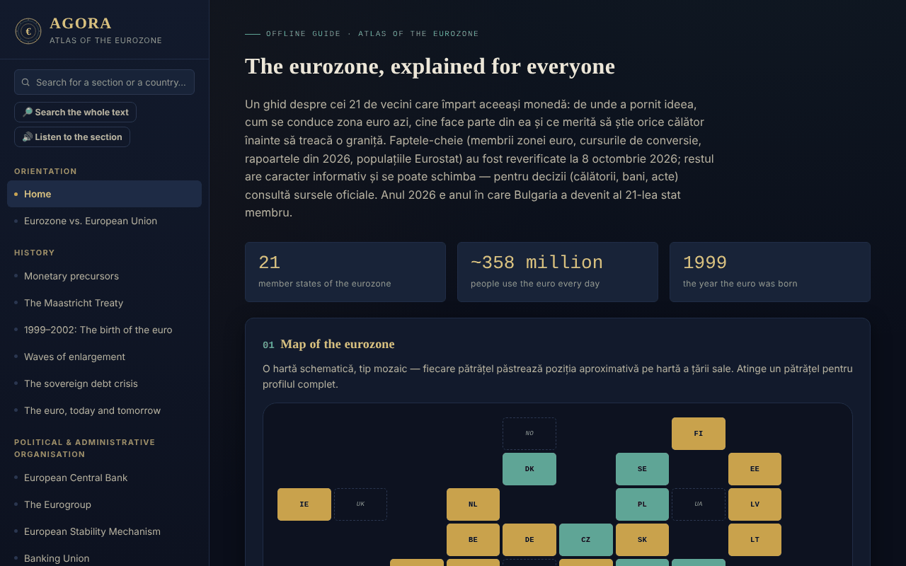

# AGORA — Atlas of the Euro Area

**English** · [Română](README.ro.md) · [Français](README.fr.md) · [Italiano](README.it.md) · [Español](README.es.md) · [Português](README.pt.md) · [Deutsch](README.de.md) · [Magyar](README.hu.md)

**Version:** 2.1.0 · **Last updated:** 2026-10-27

**Status:** stable · **Offline:** complete (no network requests; external links open only on click)

Interface languages: **Română, English, Français, Italiano, Español, Português (PT), Deutsch, Magyar**

An offline guide, in a single HTML file, to the euro area: history, institutions, the 21 member states, Romania and the euro, plus a practical guide for travellers. A personal, informational, unofficial project.

**Live app:** https://chiuta.github.io/AGORA/

**New in 2.0.0:** *State comparator* — compare the 21 euro-area states on the app's own indicators (population, area, computed density, year of euro adoption, years in the euro area) or on your own indicators with the source and date you enter; overlaid two-indicator bar chart, "what if" scenarios (percentage change → rank and share) and CSV export. No new macroeconomic data is added: only values already in the app or entered by the user are used, and what you enter stays on your device.

## Data and sources (what the atlas contains, which source, which date)

- **Scope:** the euro area with **21 states**, **including Bulgaria** (member since 1 January 2026, fixed rate 1 EUR = 1.95583 leva). Bulgaria is already present in the state list, the tile map, the history table, the quiz and the Romania section; this was re-checked on 27 October 2026.
- **Source for Bulgaria:** ECB press release of 1 January 2026 (ecb.europa.eu/press/pr/date/2026/html/ecb.pr260101~c830245e42.en.html), read on 27 October 2026: the euro enters circulation in Bulgaria on 1 January 2026, the 21st state, rate 1.95583 leva per euro (decision of July 2025).
- **Other data:** populations from Eurostat (table `tps00001`, situation on 1 January 2025); key facts from the ECB, the European Commission and Eurostat, checked by the author on **8 October 2026** (see "Verified sources"). **Not re-checked on 27 October 2026** (except Bulgaria): to be verified before decisions. Areas and VAT rates were never checked against a single official source.
- **Correction on 27 October 2026:** the population of France was changed from ~68.9 to ~68.6 million (Eurostat 68,635,900 and INSEE 68,606,000, both at 1 January 2025). **Portugal** (~11.4 million) is left unchanged: Eurostat (July 2025) gives ~10.75 million, while INE later revised it to ~11.4 million; the sources conflict, so it stays marked "to be verified". Areas and VAT remain unverified.
- **Where it is shown in the app:** footer, "Data and sources" (8 languages).

## What it is

AGORA gathers, in 59 sections (left-hand menu; ☰ on mobile), explanations about the single currency: from monetary precursors and the Maastricht Treaty to the ECB, the Eurogroup, the ESM, the convergence criteria, Romania and the euro, EU rights for travellers and a practical guide. The key facts were re-checked on **8 October 2026**, and the ECB banknote survey on **11 October 2026** (see "Verified sources"); the rest of the text is informational and may change.

## Features

Verified in code:
- A tile map of the states (euro area, EU outside the area, microstates, unilateral use) with a detail panel on click; a filterable list of states by accession wave.
- Search in the menu (diacritics-insensitive; Enter opens a country's profile) and in the glossary (33 terms).
- A 28-question quiz, in shuffled order (Fisher–Yates), with explanations; at the end a "To review" list appears (the questions answered wrongly, with the correct answer and the explanation) and the button "Retry only the wrong questions".
- Local calculators: lei–euro converter with a manually entered rate, straight-line distance between capitals (haversine), travel budget, destination recommender, packing-list generator.
- Traveller's journal: kept only in the page's memory; it can be exported/imported as a JSON file (on import, countries, dates and note length are validated).
- Day/night mode switch; on first opening, the system preference for the light theme is respected.
- Direct links to sections (`#state-membre`) and the browser's Back/Forward buttons; the "/" shortcut opens the menu search; printing (Ctrl+P) produces the current section, without the menu.

## User guide

1. Choose a section from the left-hand menu (on mobile, press ☰); you can search by title or by country.
2. In the "Interactive map", press a small tile for the country's profile; "Close ✕" hides it.
3. In "Country profiles", filter by accession wave and press a country.
4. In "Manual converter", enter the day's rate yourself (for example from bnr.ro) and the amount; the atlas does not fetch rates from the internet.
5. In "Quiz", answer the questions; at the end you review the wrong questions and can retry only those; "Start over" restarts the whole quiz.
6. In the "Traveller's journal", add visits; to keep them, use "Export (.json)" and, later, "Import (.json)".

## Privacy and network

- **Storage:** it does not use `localStorage`, `sessionStorage`, IndexedDB or cookies. The journal and the calculators' results disappear when the page is reloaded, unless you export the journal.
- **Network:** it makes no network requests (no `fetch`, scripts, fonts or external images). The CSP policy in the page blocks external connections.
- **External links** (opened only on click, in a new tab, with `rel=noopener`; sending the referrer is disabled): websites of railway operators (oebb.at, belgiantrain.be, bdz.bg, hzpp.hr, elron.ee, vr.fi, sncf-connect.com, bahn.de, hellenictrain.gr, irishrail.ie, trenitalia.com, vivi.lv, ltglink.lt, cfl.lu, ns.nl, cp.pt, zssk.sk, potniski.sz.si, renfe.com), interrail.com, thetrainline.com, omio.com, flixbus.com, mae.ro, econsulat.ro, cardeuropean.ro, chiuta.github.io and trom.tf. Mentions of commercial services (rail, fintech) are informational, not recommendations.
- **Permissions:** it requests no browser permission.
- There is no account, telemetry or traffic analysis.

## Verified sources (8 October 2026)

- Bulgaria — member of the euro area since 1 January 2026, the 21st state, fixed rate 1 EUR = 1.95583 BGN: ECOFIN Council (July 2025), ECB, Banque de France, European Parliament (EPRS).
- Convergence reports of 24 June 2026 (European Commission and ECB): reference values 2.7% (inflation) and 5.1% (long-term interest rates); Czechia and Sweden meet three of the four criteria; Romania: inflation 8.4%, interest rates 6.7%, deficit 7.9% of GDP in 2025, debt 59.3% (projection 63.4% in 2027), outside ERM II.
- Populations: Eurostat, `tps00001`, 1 January 2025 (euro area, 21 states: 358.7 million).
- Flash Eurobarometer 583 (17 April – 4 May 2026): support for the euro in Romania 65%, Hungary 80%.
- ECB, press release of 23 July 2026: ten design proposals for the new banknotes; press release of 23 September 2026: the public survey (23 July – 21 September) had 9.96 million participants, final decision around the end of 2026 (verified on 11.10.2026).
- Digital euro: vote of the European Parliament's ECON committee on 23 June 2026 (not yet in plenary).
- TAROM: first Boeing 737 MAX taken over on 12 September 2026 (aviation press).
- Presidency of the Eurogroup: Kyriakos Pierrakakis (elected in December 2025).

## Limits and warnings

- An informational, **unofficial** guide, with no legal value; it does not constitute financial, legal or medical advice and has no connection with the ECB, the European Commission or other institutions.
- Data change (exchange rates, fares, travel rules, timetables). For decisions, check the official sources.
- The states' surface areas, VAT rates, timetables and transport durations, the number of states with deposit-return systems and the information in the practical sections have not been re-checked against a single official source; treat them as indicative.
- Distances are in a straight line, not by road.
- The budget calculator uses general averages, not real prices.

## Running locally / offline

Download `index.html` and open it in a browser; it works without internet.

## New features (v1.1.0)

- **Search across the whole atlas** (the "Search the full text" button, FFF.search): matching without diacritics and tolerant of small typos ("Maastrich" finds Maastricht), with a direct jump to the section; it takes over the text from the menu search. No network.
- **Reading the section aloud** (FFF.tts), with a choice of voice.
- Shared kit (core, label, bundle, tts, search): version label, .fff.json backup.
- The new texts are in all the application's languages (including hu/de where an i18n system exists); machine translations are not natively verified.
- Tests: `tests/fff-r8.test.mjs` (network blocked, axe 0 violations at 1280 and 360 px, including with the search dialog open).

## History / Changelog

Full changelog: [`CHANGELOG.md`](CHANGELOG.md).

### 2.1.0 — 2026-10-27 (previous: v2.0.1)
- Data: France population corrected to ~68.6 million (Eurostat + INSEE); Portugal conflict documented, not changed; "Data and sources" note updated in 8 languages (non-RO/EN marked machine translation); new test `tests/date-surse.test.mjs`.

### 2.0.1 — 2026-10-27 (previous: v2.0.0)
- Texts: expanded description (meta, social card, `app.json`), "Data and sources" block in the footer in 8 languages, Bulgaria re-checked against the ECB press release of 1 January 2026.

### 1.2.5 — 2026-10-22
- fff-kit 1.1.4: touch targets and minimum text size; touch targets/text fixed

### 1.2.4 — 2026-10-22
- fff-kit 1.1.2: PBKDF2 600,000 iterations, anti-clickjacking protection

### 1.2.3 — 2026-10-22
- Accessibility: the trip-journal country, date and import fields now have names announced by screen readers (all 8 languages).
- Mobile: text, tiles and table headers are at least 12 px on narrow screens; the version button has a larger touch target.

### 1.2.2 — 2026-10-22
- Fixed leftover Romanian text in the other languages: the two section headings (new banknote series, European deposit insurance scheme) and the two footer lines are now translated.

### 14 October 2026 (v1.1.0)
- New: local search across the whole atlas, reading the section aloud, shared kit, tests.

### 1.0.0 — 12 October 2026
- The version and the date of the last update are shown in the application (footer).

### 11.10.2026 (third update) — 11 October 2026
- Quiz: the result lists the wrongly answered questions ("To review") with the correct answer and the explanation and allows retrying only those (everything stays in the page's memory).

### 11.10.2026 (second update) — 11 October 2026
- Direct links to sections through `#id`, with Back/Forward working and an updated page title (no local storage).
- The system's light theme is respected on first opening; print style for the current section; the "/" shortcut for the menu search.

### 11.10.2026 — 11 October 2026
- Accessibility: h1 heading (AGORA), semantic header for the mobile bar; axe check with no violations.
- Update: the ECB survey on the new banknotes has ended (21 September 2026, 9.96 million participants; final decision around the end of 2026; circulation from the 2030s).

## License

The license has not yet been declared.

## Author

Alexio — Alexandru-Ionuț Chiuță, contact: alexio@trom.tf

## Summary

AGORA is a single-file, offline Romanian-language atlas of the euro area (21 members since Bulgaria joined on 1 January 2026): history, institutions, country profiles, Romania and the euro, and a traveller's guide, with a tile map, quiz, glossary and small local calculators. No storage, no network requests, no permissions; the trip journal lives in memory and can be exported/imported as JSON. Key facts were re-checked on 8 October 2026 against ECB, European Commission and Eurostat sources; other content is informational. License not yet declared.
