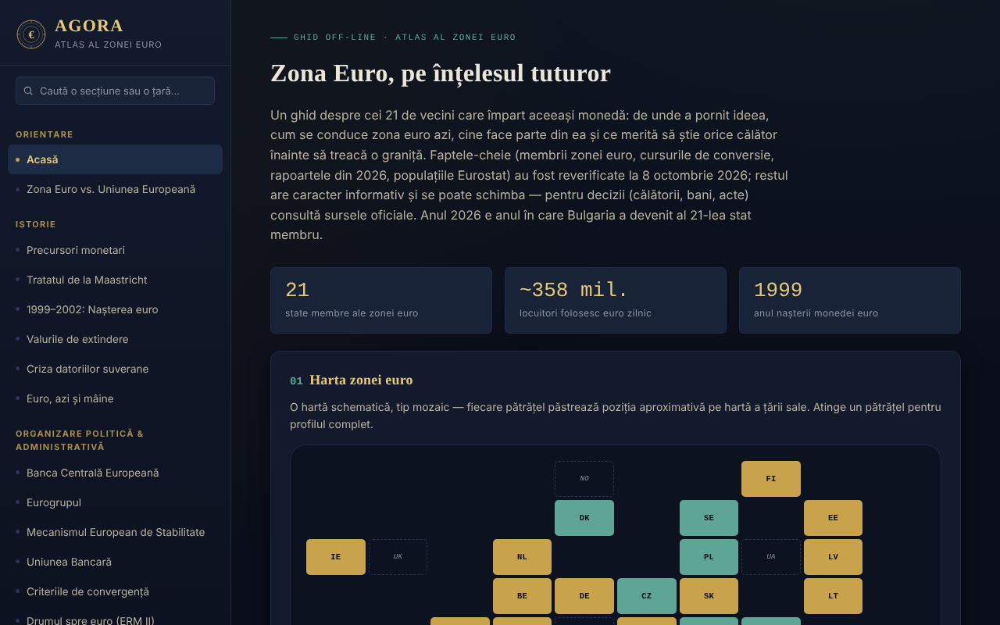

# AGORA — Atlas da Zona Euro

[English](README.md) · [Română](README.ro.md) · [Français](README.fr.md) · [Italiano](README.it.md) · [Español](README.es.md) · **Português** · [Deutsch](README.de.md) · [Magyar](README.hu.md)

**Versão:** 1.2.0 · **Última atualização:** 2026-10-19

Idiomas da interface: **Română, English, Français, Italiano, Español, Português (PT), Deutsch, Magyar**

Guia offline, num único ficheiro HTML, sobre a zona euro: história, instituições, os 21 Estados-Membros, a Roménia e o euro, além de um guia prático para viajantes. Projeto pessoal, informativo, não oficial.

**Aplicação online:** https://chiuta.github.io/AGORA/

## O que é

O AGORA reúne em 59 secções (menu à esquerda; ☰ no telemóvel) explicações sobre a moeda única: desde os precursores monetários e o Tratado de Maastricht até ao BCE, ao Eurogrupo, ao MEE, aos critérios de convergência, à Roménia e o euro, aos direitos dos viajantes na UE e a um guia prático. Os factos essenciais foram reverificados em **8 de outubro de 2026**, e o inquérito do BCE sobre as notas em **11 de outubro de 2026** (ver «Fontes verificadas»); o resto do texto é informativo e pode mudar.

## Funcionalidades

Verificadas no código:
- Mapa em mosaico dos Estados (zona euro, UE fora da zona, microestados, utilização unilateral) com painel de detalhe ao tocar; lista filtrável de Estados por vaga de adesão.
- Pesquisa no menu (insensível a diacríticos; Enter abre o perfil de um país) e no glossário (33 termos).
- Questionário de 28 perguntas, em ordem aleatória (Fisher–Yates), com explicações; no final surge a lista «A rever» (as perguntas erradas, com a resposta correta e a explicação) e o botão «Repetir apenas as perguntas erradas».
- Calculadoras locais: conversor leu–euro com taxa introduzida manualmente, distância em linha reta entre capitais (haversine), orçamento de viagem, recomendador de destinos, gerador de lista de bagagem.
- Diário do viajante: mantido apenas na memória da página; pode ser exportado/importado como ficheiro JSON (na importação são validados os países, as datas e o comprimento das notas).
- Comutador de modo dia/noite; na primeira abertura é respeitada a preferência do sistema pelo tema claro.
- Ligações diretas para secções (`#state-membre`) e botões Recuar/Avançar do navegador; o atalho «/» abre a pesquisa do menu; a impressão (Ctrl+P) produz a secção atual, sem o menu.

## Manual de utilização

1. Escolha uma secção no menu à esquerda (no telemóvel, prima ☰); pode pesquisar por título ou por país.
2. No «Mapa interativo», prima um quadradinho para ver o perfil do país; «Fechar ✕» oculta-o.
3. Em «Perfis de países», filtre por vaga de adesão e prima um país.
4. Em «Conversor manual», introduza você mesmo a taxa do dia (por exemplo, de bnr.ro) e o montante; o atlas não obtém taxas da internet.
5. No «Questionário», responda às perguntas; no final reveja as erradas e pode repetir apenas essas; «Recomeçar» reinicia todo o questionário.
6. No «Diário do viajante», adicione visitas; para as guardar, use «Exportar (.json)» e, mais tarde, «Importar (.json)».

## Privacidade e rede

- **Armazenamento:** não utiliza `localStorage`, `sessionStorage`, IndexedDB nem cookies. O diário e os resultados das calculadoras desaparecem ao recarregar a página, a menos que exporte o diário.
- **Rede:** não faz pedidos de rede (sem `fetch`, scripts, tipos de letra ou imagens externos). A política CSP da página bloqueia ligações externas.
- **Ligações externas** (abrem-se apenas ao clicar, num novo separador, com `rel=noopener`; o envio do referrer está desativado): sítios de operadores ferroviários (oebb.at, belgiantrain.be, bdz.bg, hzpp.hr, elron.ee, vr.fi, sncf-connect.com, bahn.de, hellenictrain.gr, irishrail.ie, trenitalia.com, vivi.lv, ltglink.lt, cfl.lu, ns.nl, cp.pt, zssk.sk, potniski.sz.si, renfe.com), interrail.com, thetrainline.com, omio.com, flixbus.com, mae.ro, econsulat.ro, cardeuropean.ro, chiuta.github.io e trom.tf. As menções a serviços comerciais (ferroviários, fintech) são informativas, não recomendações.
- **Permissões:** não pede nenhuma permissão ao navegador.
- Não há conta, telemetria nem análise de tráfego.

## Fontes verificadas (8 de outubro de 2026)

- Bulgária — membro da zona euro desde 1 de janeiro de 2026, 21.º Estado, taxa fixa 1 EUR = 1,95583 BGN: Conselho ECOFIN (julho de 2025), BCE, Banque de France, Parlamento Europeu (EPRS).
- Relatórios de convergência de 24 de junho de 2026 (Comissão Europeia e BCE): valores de referência 2,7 % (inflação) e 5,1 % (taxas de juro de longo prazo); a Chéquia e a Suécia cumprem três dos quatro critérios; Roménia: inflação 8,4 %, taxas de juro 6,7 %, défice de 7,9 % do PIB em 2025, dívida 59,3 % (projeção 63,4 % em 2027), fora do MTC II.
- Populações: Eurostat, `tps00001`, 1 de janeiro de 2025 (zona euro, 21 Estados: 358,7 milhões).
- Flash Eurobarómetro 583 (17 de abril – 4 de maio de 2026): apoio ao euro na Roménia 65 %, na Hungria 80 %.
- BCE, comunicado de 23 de julho de 2026: dez propostas de design para as novas notas; comunicado de 23 de setembro de 2026: o inquérito público (23 de julho – 21 de setembro) teve 9,96 milhões de participantes, decisão final por volta do final de 2026 (verificado em 11.10.2026).
- Euro digital: votação da comissão ECON do Parlamento Europeu em 23 de junho de 2026 (ainda não em plenário).
- TAROM: primeiro Boeing 737 MAX recebido em 12 de setembro de 2026 (imprensa de aviação).
- Presidência do Eurogrupo: Kyriakos Pierrakakis (eleito em dezembro de 2025).

## Limites e avisos

- Guia informativo, **não oficial**, sem valor jurídico; não constitui aconselhamento financeiro, jurídico ou médico e não tem qualquer ligação com o BCE, a Comissão Europeia ou outras instituições.
- Os dados mudam (taxas de câmbio, tarifas, regras de viagem, horários). Para decisões, verifique as fontes oficiais.
- As superfícies dos Estados, as taxas de IVA, os horários e durações de transporte, o número de Estados com sistemas de depósito e reembolso e as informações das secções práticas não foram reverificados numa única fonte oficial; trate-os como indicativos.
- As distâncias são em linha reta, não rodoviárias.
- A calculadora de orçamento usa médias gerais, não preços reais.

## Execução local / offline

Descarregue `index.html` e abra-o num navegador; funciona sem internet.

## Novidades (v1.1.0)

- **Pesquisa em todo o atlas** (botão «Pesquisar em todo o texto», FFF.search): correspondência sem diacríticos e tolerante a pequenos erros («Maastrich» encontra Maastricht), com salto direto para a secção; aproveita o texto da pesquisa do menu. Sem rede.
- **Leitura da secção em voz alta** (FFF.tts), com escolha da voz.
- Kit comum (core, label, bundle, tts, search): etiqueta de versão, cópia .fff.json.
- Os novos textos estão em todos os idiomas da aplicação (incluindo hu/de onde existe um sistema i18n); as traduções automáticas não foram verificadas por falantes nativos.
- Testes: `tests/fff-r8.test.mjs` (rede bloqueada, axe 0 violações a 1280 e 360 px, inclusive com a caixa de diálogo de pesquisa aberta).

## Histórico / Registo de alterações

### 14 de outubro de 2026 (v1.1.0)
- Novo: pesquisa local em todo o atlas, leitura da secção em voz alta, kit comum, testes.

### 1.0.0 — 12 de outubro de 2026
- A versão e a data da última atualização são mostradas na aplicação (rodapé).

### 11.10.2026 (terceira atualização) — 11 de outubro de 2026
- Questionário: o resultado lista as perguntas erradas («A rever») com a resposta correta e a explicação e permite repetir apenas essas (tudo permanece na memória da página).

### 11.10.2026 (segunda atualização) — 11 de outubro de 2026
- Ligações diretas para secções através de `#id`, com Recuar/Avançar funcionais e título da página atualizado (sem armazenamento local).
- O tema claro do sistema é respeitado na primeira abertura; estilo de impressão para a secção atual; atalho «/» para a pesquisa do menu.

### 11.10.2026 — 11 de outubro de 2026
- Acessibilidade: título h1 (AGORA), cabeçalho semântico para a barra móvel; verificação axe sem violações.
- Atualização: o inquérito do BCE sobre as novas notas terminou (21 de setembro de 2026, 9,96 milhões de participantes; decisão final por volta do final de 2026; circulação a partir da década de 2030).

## Licença

A licença ainda não está declarada.

## Autor

Alexio — Alexandru-Ionuț Chiuță, contacto: alexio@trom.tf

## Resumo

O AGORA é um atlas offline, num único ficheiro e em romeno, da zona euro (21 membros desde a adesão da Bulgária em 1 de janeiro de 2026): história, instituições, perfis de países, a Roménia e o euro, e um guia do viajante, com mapa em mosaico, questionário, glossário e pequenas calculadoras locais. Sem armazenamento, sem pedidos de rede, sem permissões; o diário de viagem vive em memória e pode ser exportado/importado como JSON. Os factos essenciais foram reverificados em 8 de outubro de 2026 com fontes do BCE, da Comissão Europeia e do Eurostat; o resto do conteúdo é informativo. Licença ainda não declarada.
