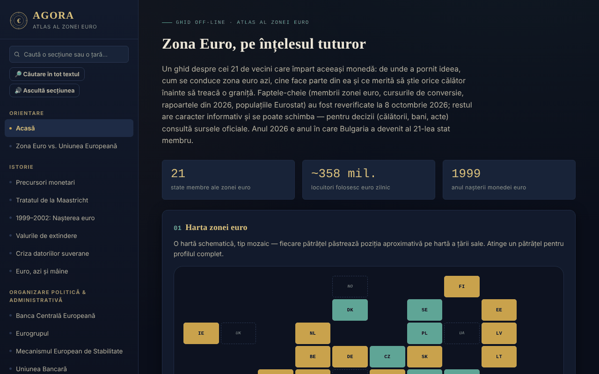

# AGORA — Atlas al Zonei Euro

[English](README.md) · **Română** · [Français](README.fr.md) · [Italiano](README.it.md) · [Español](README.es.md) · [Português](README.pt.md) · [Deutsch](README.de.md) · [Magyar](README.hu.md)

**Versiune:** 1.2.5 · **Ultima actualizare:** 2026-10-22

Limbile interfeței: **Română, English, Français, Italiano, Español, Português (PT), Deutsch, Magyar**

Ghid offline, într-un singur fișier HTML, despre zona euro: istorie, instituții, cele 21 de state membre, România și euro, plus un ghid practic pentru călători. Proiect personal, informativ, neoficial.

**Live:** https://chiuta.github.io/AGORA/

## Ce este

AGORA adună în 59 de secțiuni (meniul din stânga; ☰ pe mobil) explicații despre moneda unică: de la precursorii monetari și Tratatul de la Maastricht, la BCE, Eurogrup, MES, criteriile de convergență, România și euro, drepturi UE pentru călători și un ghid practic. Faptele-cheie au fost reverificate la **8 octombrie 2026**, iar sondajul BCE privind bancnotele la **11 octombrie 2026** (vezi „Surse verificate"); restul textului este informativ și se poate schimba.

## Funcții

Verificate în cod:
- Hartă mozaic a statelor (zona euro, UE în afara zonei, microstate, folosire unilaterală) cu panou de detaliu la apăsare; listă filtrabilă de state pe valuri de aderare.
- Căutare în meniu (insensibilă la diacritice; Enter deschide profilul unei țări) și în glosar (33 de termeni).
- Chestionar de 28 de întrebări, în ordine amestecată (Fisher–Yates), cu explicații; la final apare lista „De revăzut” (întrebările greșite, cu răspunsul corect și explicația) și butonul „Reia doar întrebările greșite”.
- Calculatoare locale: convertor leu–euro cu curs introdus manual, distanță în linie dreaptă între capitale (haversine), buget de călătorie, recomandator de destinație, generator de listă de bagaje.
- Jurnalul călătorului: se ține doar în memoria paginii; poate fi exportat/importat ca fișier JSON (la import se validează țările, datele și lungimea notițelor).
- Comutator regim zi/noapte; la prima deschidere se respectă preferința sistemului pentru tema luminoasă.
- Legături directe către secțiuni (`#state-membre`) și butoanele Înapoi/Înainte ale browserului; scurtătura „/” deschide căutarea din meniu; tipărirea (Ctrl+P) produce secțiunea curentă, fără meniu.

## Manual de utilizare

1. Alege o secțiune din meniul din stânga (pe mobil, apasă ☰); poți căuta după titlu sau după țară.
2. În „Harta interactivă" apasă un pătrățel pentru profilul țării; „Închide ✕" îl ascunde.
3. În „Profiluri de țară" filtrează după valul de aderare și apasă o țară.
4. La „Convertor manual" introdu tu cursul zilei (de exemplu de pe bnr.ro) și suma; atlasul nu preia cursuri de pe internet.
5. În „Chestionar" răspunde la întrebări; la final revezi întrebările greșite și poți relua doar acele întrebări; „Ia-o de la capăt" repornește tot chestionarul.
6. În „Jurnalul călătorului" adaugă vizite; ca să le păstrezi, folosește „Exportă (.json)" și, ulterior, „Importă (.json)".

## Confidențialitate și rețea

- **Stocare:** nu folosește `localStorage`, `sessionStorage`, IndexedDB sau cookie-uri. Jurnalul și rezultatele calculatoarelor dispar la reîncărcarea paginii, dacă nu exporți jurnalul.
- **Rețea:** nu face cereri de rețea (fără `fetch`, scripturi, fonturi sau imagini externe). Politica CSP din pagină blochează conexiunile externe.
- **Linkuri externe** (se deschid doar la apăsare, în filă nouă, cu `rel=noopener`; trimiterea referrer-ului este dezactivată): site-uri ale operatorilor feroviari (oebb.at, belgiantrain.be, bdz.bg, hzpp.hr, elron.ee, vr.fi, sncf-connect.com, bahn.de, hellenictrain.gr, irishrail.ie, trenitalia.com, vivi.lv, ltglink.lt, cfl.lu, ns.nl, cp.pt, zssk.sk, potniski.sz.si, renfe.com), interrail.com, thetrainline.com, omio.com, flixbus.com, mae.ro, econsulat.ro, cardeuropean.ro, chiuta.github.io și trom.tf. Mențiunile de servicii comerciale (feroviare, fintech) sunt informative, nu recomandări.
- **Permisiuni:** nu cere nicio permisiune a browserului.
- Nu există cont, telemetrie sau analiză de trafic.

## Surse verificate (8 octombrie 2026)

- Bulgaria — membră a zonei euro din 1 ianuarie 2026, al 21-lea stat, curs fix 1 EUR = 1,95583 BGN: Consiliul ECOFIN (iulie 2025), BCE, Banque de France, Parlamentul European (EPRS).
- Rapoartele de convergență din 24 iunie 2026 (Comisia Europeană și BCE): valori de referință 2,7% (inflație) și 5,1% (dobânzi pe termen lung); Cehia și Suedia îndeplinesc trei din patru criterii; România: inflație 8,4%, dobânzi 6,7%, deficit 7,9% din PIB în 2025, datorie 59,3% (proiecție 63,4% în 2027), în afara ERM II.
- Populații: Eurostat, `tps00001`, 1 ianuarie 2025 (zona euro, 21 de state: 358,7 mil.).
- Flash Eurobarometer 583 (17 aprilie – 4 mai 2026): sprijin pentru euro în România 65%, Ungaria 80%.
- BCE, comunicat din 23 iulie 2026: zece propuneri de design pentru bancnotele noi; comunicatul din 23 septembrie 2026: sondajul public (23 iulie – 21 septembrie) a avut 9,96 milioane de participanți, decizia finală în jurul sfârșitului lui 2026 (verificat la 11.10.2026).
- Euro digital: votul comisiei ECON a Parlamentului European din 23 iunie 2026 (nu încă în plen).
- TAROM: primul Boeing 737 MAX preluat pe 12 septembrie 2026 (presa de aviație).
- Președinția Eurogrupului: Kyriakos Pierrakakis (ales în decembrie 2025).

## Limite și avertismente

- Ghid informativ, **neoficial**, fără valoare juridică; nu constituie consiliere financiară, juridică sau medicală și nu are legătură cu BCE, Comisia Europeană sau alte instituții.
- Datele se schimbă (cursuri, tarife, reguli de călătorie, programe). Pentru decizii, verifică sursele oficiale.
- Suprafețele statelor, cotele TVA, orarele și duratele de transport, numărul de state cu sisteme de garanție-returnare și informațiile din secțiunile practice nu au fost reverificate la o sursă oficială unică; tratează-le ca orientative.
- Distanțele sunt în linie dreaptă, nu rutiere.
- Calculatorul de buget folosește medii generale, nu prețuri reale.

## Rulare locală / offline

Descarcă `index.html` și deschide-l în browser; funcționează fără internet.

## Funcții noi (v1.1.0)

- **Căutare în tot atlasul** (butonul „Căutare în tot textul”, FFF.search): potrivire fără diacritice și cu mici greșeli („Maastrich” găsește Maastricht), cu salt direct la secțiune; preia textul din căutarea din meniu. Fără rețea.
- **Citirea secțiunii cu voce** (FFF.tts), cu alegerea vocii.
- Kit comun (core, label, bundle, tts, search): etichetă de versiune, copie .fff.json.
- Textele noi sunt în toate limbile aplicației (inclusiv hu/de unde există sistem i18n); traducerile automate sunt neverificate nativ.
- Teste: `tests/fff-r8.test.mjs` (rețea blocată, axe 0 violări la 1280 și 360 px, inclusiv cu dialogul de căutare deschis).

## Istoric / Changelog

### 1.2.5 — 2026-10-22
- fff-kit 1.1.4: ținte tactile și text minim; ținte tactile/text corectate

### 1.2.4 — 2026-10-22
- fff-kit 1.1.2: PBKDF2 600 000 iterații, protecție anti-clickjacking

### 1.2.3 — 2026-10-22
- Accesibilitate: câmpurile țară, dată și import din jurnalul călătorului au acum nume anunțate de cititoarele de ecran (în toate cele 8 limbi).
- Mobil: textul, plăcuțele și antetele de tabel au cel puțin 12 px pe ecrane înguste; butonul de versiune are o țintă tactilă mai mare.

### 1.2.2 — 2026-10-22
- Remediate rămășițele în română din celelalte limbi: cele două titluri de secțiune (noua serie de bancnote, schema europeană de garantare a depozitelor) și cele două rânduri din subsol sunt acum traduse.

### 14 octombrie 2026 (v1.1.0)
- Nou: căutare locală în tot atlasul, citirea secțiunii cu voce, kit comun, teste.

### 1.0.0 — 12 octombrie 2026
- Versiunea și data ultimei actualizări sunt afișate în aplicație (subsol).

### 11.10.2026 (a treia actualizare) — 11 octombrie 2026
- Chestionar: rezultatul listează întrebările greșite („De revăzut”) cu răspunsul corect și explicația și permite reluarea doar a acestora (totul rămâne în memoria paginii).

### 11.10.2026 (a doua actualizare) — 11 octombrie 2026
- Legături directe către secțiuni prin `#id`, cu Înapoi/Înainte funcționale și titlu de pagină actualizat (fără stocare locală).
- Tema luminoasă a sistemului este respectată la prima deschidere; stil de tipărire pentru secțiunea curentă; scurtătura „/” pentru căutarea din meniu.

### 11.10.2026 — 11 octombrie 2026
- Accesibilitate: titlu h1 (AGORA), antet semantic pentru bara mobilă; verificare axe fără încălcări.
- Actualizare: sondajul BCE privind bancnotele noi s-a încheiat (21 septembrie 2026, 9,96 milioane de participanți; decizia finală în jurul sfârșitului lui 2026; circulație din anii 2030).

## Licență

Licența nu este încă declarată.

## Autor

Alexio — Alexandru-Ionuț Chiuță, contact: alexio@trom.tf

## Rezumat

AGORA este un atlas într-un singur fișier, offline, în limba română, al zonei euro (21 de membri de la aderarea Bulgariei la 1 ianuarie 2026): istorie, instituții, profiluri de țară, România și euro și un ghid al călătorului, cu hartă din plăci, test, glosar și mici calculatoare locale. Fără stocare, fără cereri de rețea, fără permisiuni; jurnalul de călătorie rămâne în memorie și poate fi exportat/importat ca JSON. Faptele-cheie au fost reverificate la 8 octombrie 2026 față de surse BCE, Comisia Europeană și Eurostat; restul conținutului are caracter informativ. Licență nedeclarată încă.
